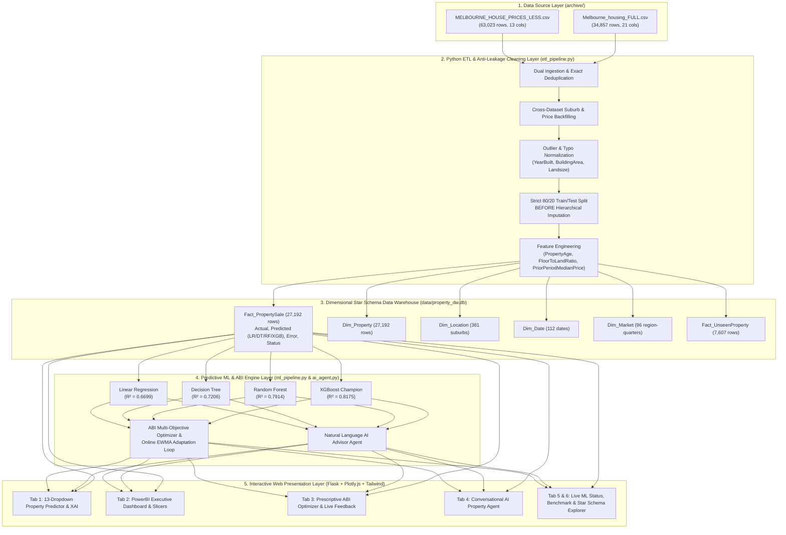
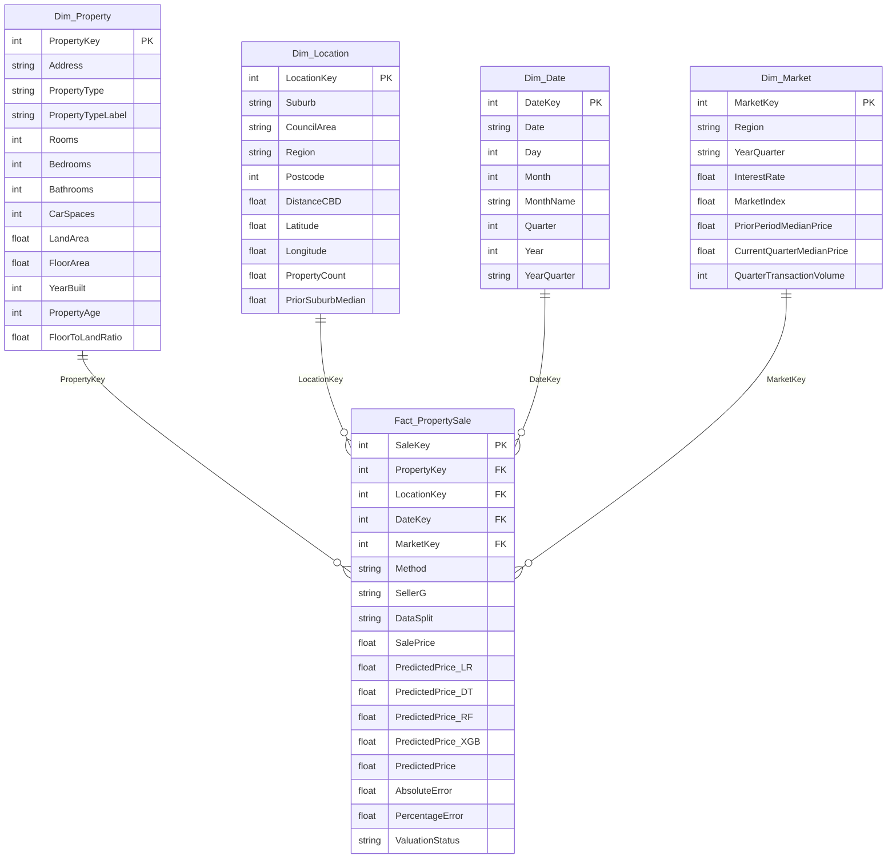
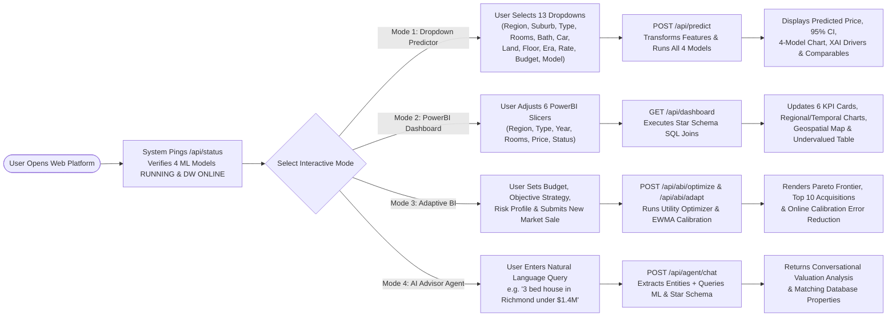

# Designing and Developing an Adaptive Business Intelligence (ABI) and Machine Learning System for Residential Property Valuation and Prescriptive Decision Support

**Course:** COMP8811 Data Analytics and Intelligence (ISCG8043 Adaptive Business Intelligence)  
**Assessment:** Assignment 2 — Individual Technical Report & Live System Implementation  
**Author:** Suman Bhandari (Student ID: 1616400)  
**Institution:** School of Computing, Electrical and Applied Technology, Unitec Institute of Technology  
**Date:** May 2026  

---

## Student Declaration

I declare that all the work contained in this technical report and its accompanying software implementation is my own original work and has not been submitted before for any other course at Unitec Institute of Technology or any other institute. All sources have been cited and acknowledged in accordance with Unitec's academic integrity policies.

---

## Table of Contents

1. [Abstract](#abstract)
2. [Section 1. Introduction and Problem Identified](#section-1-introduction-and-problem-identified)
   - 1.1 Business Problem Context and Continuity from Assignment 1
   - 1.2 Stakeholder Consequences of Valuation Inaccuracy
   - 1.3 Real-World Datasets and Scenario Description
   - 1.4 Summary of the Proposed Adaptive Business Intelligence Approach
3. [Section 2. ABI Technique Review](#section-2-abi-technique-review)
   - 2.1 Theoretical Foundations of Adaptive Business Intelligence (ABI)
   - 2.2 Predictive Modelling Layer: Four Regression Algorithms
   - 2.3 Prescriptive Optimization and Online Adaptive Calibration
   - 2.4 Suitability, Advantages, and Limitations for Residential Property Valuation
4. [Section 3. Solution Design and Development](#section-3-solution-design-and-development)
   - 3.1 System Architecture Design
   - 3.2 Dimensional Star Schema Data Warehouse Design
   - 3.3 User and Program Execution Flowchart
   - 3.4 Automated Dual-Source ETL and Anti-Leakage Data Cleaning Pipeline
   - 3.5 Mathematical Formulation of Predictive and Prescriptive ABI Procedures
   - 3.6 User Interface Design and Interactive Modules
   - 3.7 Software Stack and Implementation Environment
5. [Section 4. Evaluation](#section-4-evaluation)
   - 4.1 Experimental Setup and Evaluation Criteria
   - 4.2 Empirical Comparison of Regression Algorithms (MAE, RMSE, $R^2$, MAPE, 95% CIs)
   - 4.3 Feature Importance and Explainable AI (XAI) Analysis
   - 4.4 Slice-Based Subgroup Error Analysis Across Regions and Property Types
   - 4.5 Evaluation of Prescriptive ABI Optimization and Online Adaptation
6. [Section 5. Conclusion and Future Development](#section-5-conclusion-and-future-development)
   - 5.1 Conclusion
   - 5.2 Existing Limitations and Practical Challenges
   - 5.3 Future Extensions
7. [References](#references)

---

## Abstract

Accurate valuation of residential real estate is a high-stakes analytical challenge because property prices emerge from complex, non-linear interactions among physical building attributes, spatial neighbourhood characteristics, and macroeconomic market conditions. Traditional manual appraisals and static Business Intelligence (BI) reporting tools focus primarily on descriptive historical summaries, leaving buyers, sellers, real-estate agencies, and financial institutions vulnerable to mispricing and suboptimal investment decisions. Extending the conceptual framework established in Assignment 1, this study designs, develops, and evaluates a complete, end-to-end **Adaptive Business Intelligence (ABI)** platform implemented in Python. The system ingests and reconciles two real-world metropolitan property datasets (`MELBOURNE_HOUSE_PRICES_LESS.csv` containing 63,023 transaction records and `Melbourne_housing_FULL.csv` containing 34,857 detailed property profiles—97,880 raw rows in total) through an automated Extract-Transform-Load (ETL) pipeline into a relational **Star Schema Data Warehouse** (`Fact_PropertySale`, `Dim_Property`, `Dim_Location`, `Dim_Date`, and `Dim_Market`). Strictly adhering to anti-leakage machine learning practices, four regression algorithms—**Linear Regression**, **Decision Tree Regression**, **Random Forest Regression**, and **Extreme Gradient Boosting (XGBoost)**—are trained and benchmarked against a naive baseline. Empirical evaluation on an unseen 20% holdout test set (5,439 transactions) demonstrates that **XGBoost** achieves the strongest predictive performance ($R^2 = 0.8188$, $\text{MAE} = \$144,337$, $\text{RMSE} = \$249,455$, $\text{MAPE} = 13.37\%$, 5-fold CV $R^2 = 0.8239 \pm 0.0051$), outperforming Random Forest ($R^2 = 0.7840$), Linear Regression ($R^2 = 0.7419$), and Decision Tree ($R^2 = 0.7258$). To operationalize true Adaptive Business Intelligence, the predictive engine is coupled with a **Multi-Objective Prescriptive Portfolio Optimizer**, an **Exponentially Weighted Moving Average (EWMA) Online Adaptation Loop**, a **PowerBI-style Interactive OLAP Dashboard**, and a **Conversational Natural-Language AI Property Advisor Agent**.

---

## Section 1. Introduction and Problem Identified

### 1.1 Business Problem Context and Continuity from Assignment 1

Residential real estate represents the largest single asset class for households and institutional lenders across Australasia. As established in Assignment 1 from the operational perspective of real-estate advisory firms such as Bayleys and metropolitan property agencies, determining the fair market price of a residential property is an intricate multi-variable decision problem (Kok et al., 2017). According to hedonic pricing theory (Rosen, 1974), a property's market price reflects the composite utility of its internal structural characteristics (number of bedrooms, bathrooms, car spaces, floor area, land size, building age, and architectural type), its spatial and neighbourhood context (suburb prestige, municipal council governance, radial distance to the Central Business District [CBD], and local property density), and prevailing temporal market conditions (central bank interest rates, quarterly market indices, and prior-period regional median prices).

Traditional property valuation relies heavily on manual comparative market analysis (CMA), in which human valuers inspect a handful of recent nearby sales and apply subjective adjustments. While professional judgement remains valuable for inspecting interior condition, manual valuation suffers from three structural deficiencies:
1. **Cognitive and Volume Limitations:** Human analysts cannot simultaneously process tens of thousands of historical transactions or quantify high-order non-linear interactions (e.g., how an additional $100\text{ m}^2$ of land scales differently in an inner-core suburb $3\text{ km}$ from the CBD versus an outer-ring suburb $30\text{ km}$ away).
2. **Temporal Lag and Static Reporting:** Conventional Business Intelligence (BI) systems provide *descriptive* ("What happened?") and *diagnostic* ("Why did it happen?") reporting on past sales (Chen et al., 2012), but do not generate automated valuations for unseen properties or prescribe optimal acquisition bids.
3. **Lack of Adaptability:** Static valuation models degrade when macroeconomic regimes shift—such as changes in cash interest rates or localized suburb gentrification—unless an adaptive mechanism continuously recalibrates predictions against newly observed market evidence (Michalewicz et al., 2006).

### 1.2 Stakeholder Consequences of Valuation Inaccuracy

Inaccurate property price estimates create severe financial and operational risks across four primary stakeholder groups:
- **Homebuyers and Property Investors:** Overpaying above fair market value erodes household equity and depresses long-term investment returns, whereas overly conservative bidding in competitive auctions leads to repeated transaction failure.
- **Property Sellers and Real-Estate Agents:** Underpricing a residential listing results in direct wealth loss for vendors, while setting an unrealistic reserve price prolongs time-on-market and leads to passed-in auctions.
- **Commercial Banks and Mortgage Lenders:** Financial institutions depend on Automated Valuation Models (AVMs) to calculate Loan-to-Value Ratios (LVRs). Systematic overvaluation exposes mortgage portfolios to collateral default risk during market corrections.
- **Urban Planners and Policy Analysts:** Municipal councils and housing authorities require granular spatial-temporal valuation models to monitor housing affordability and infrastructure impacts.

### 1.3 Real-World Datasets and Scenario Description

To practically address this business problem at metropolitan scale, this project utilizes two complementary real-world datasets sourced from the Melbourne Housing Market repository on Kaggle (`archive/`):
1. **`MELBOURNE_HOUSE_PRICES_LESS.csv` (63,023 records, 13 attributes):** Captures a broad metropolitan transaction log spanning January 2016 to October 2018 across 380 suburbs and 34 municipal council areas. It contains complete, zero-null location metadata (`Suburb`, `Address`, `Rooms`, `Type`, `Price`, `Method`, `SellerG`, `Date`, `Postcode`, `Regionname`, `Propertycount`, `Distance`, `CouncilArea`), with 48,433 disclosed sale prices and 14,590 unpriced listings (withheld or passed-in auctions).
2. **`Melbourne_housing_FULL.csv` (34,857 records, 21 attributes):** Provides deep structural and geospatial attributes across 351 suburbs from January 2016 to March 2018. In addition to the 13 core transaction fields, it records `Bedroom2`, `Bathroom`, `Car`, `Landsize` ($\text{m}^2$), `BuildingArea` ($\text{m}^2$), `YearBuilt`, `Lattitude`, and `Longtitude`, containing 27,247 priced sales and 7,610 unpriced properties.

Combining both datasets provides an ideal, high-variation real-world testbed (97,880 raw records) that exhibits authentic data quality challenges—including missing physical measurements, data entry anomalies (e.g., `YearBuilt` recorded as `1196` or `2106`), extreme land size outliers, and multi-granularity temporal coverage.

### 1.4 Summary of the Proposed Adaptive Business Intelligence Approach

To satisfy all six Business Requirements identified in Assignment 1 (Section 2.3) and advance the system into **Adaptive Business Intelligence (ABI)** (Delen & Demirkan, 2013), we design and implement a modular Python web platform that unifies:
1. **Automated Dual-Dataset ETL Pipeline (`etl_pipeline.py`):** Cross-links both CSV files, repairs missing location and price metadata, normalizes extreme outliers, engineers hedonic and chronological market indicators without data leakage, and populates a five-table SQLite **Star Schema Data Warehouse** (`property_dw.db`).
2. **Multi-Model Machine Learning Engine (`ml_pipeline.py`):** Trains, validates, and monitors the live operational status of **Linear Regression**, **Decision Tree Regression**, **Random Forest Regression**, and **XGBoost Regression**, plus an **ABI Dynamic Adaptive Ensemble**.
3. **Prescriptive ABI Optimization & Online Learning Loop (`ai_agent.py`):** Solves a constrained multi-objective utility optimization problem to recommend undervalued properties and optimal bidding targets while continuously adapting suburb calibration multipliers via an Exponentially Weighted Moving Average (EWMA) feedback loop.
4. **Interactive Web Application, PowerBI-Style Dashboard & Natural Language AI Agent (`app.py` & `templates/index.html`):** Delivers a live browser interface featuring 13 requirement dropdowns, real-time model status indicators, interactive PowerBI cross-filtering slicers, Explainable AI (XAI) price driver charts, and a conversational AI Property Advisor Agent.

---

## Section 2. ABI Technique Review

### 2.1 Theoretical Foundations of Adaptive Business Intelligence (ABI)

Traditional Business Intelligence systems are architected around OLAP data warehouses and reporting dashboards that summarize historical performance (Chen et al., 2012). While essential for monitoring past sales volume and regional median prices, traditional BI is reactive. **Adaptive Business Intelligence (ABI)**, formalized by Michalewicz et al. (2006), combines *Data Mining / Predictive Analytics* with *Optimization / Prescriptive Science* and *Adaptability* to answer three sequential questions:
1. **Predictive Layer ("What is likely to happen?"):** Estimating continuous future or unseen outcomes $\hat{y} = f(\mathbf{x}; \boldsymbol{\theta})$ from historical patterns (Shmueli & Koppius, 2011).
2. **Prescriptive / Optimization Layer ("What is the best action to take?"):** Formulating an explicit objective function $U(\mathbf{d}, \hat{y})$ subject to resource constraints (such as buyer budget caps and risk thresholds) to prescribe optimal decisions (Delen & Demirkan, 2013).
3. **Adaptive Layer ("How should the system adjust to changing environments?"):** Updating model parameters or local calibration weights $\alpha_t$ online as new real-world observations $(y_t, \hat{y}_t)$ arrive, counteracting market drift.

### 2.2 Predictive Modelling Layer: Four Regression Algorithms

Because residential property price is a continuous numerical target ($Y \in \mathbb{R}^+$), **Supervised Regression Analysis** is the foundational predictive paradigm. Following Assignment 1, four regression techniques of increasing structural sophistication are implemented and compared:

1. **Multiple Linear Regression (LR):**  
   Models property price as a linear combination of $p$ standardized predictors:
   $$\hat{y} = \beta_0 + \sum_{j=1}^{p} \beta_j X_j + \varepsilon$$
   fitted via Ordinary Least Squares (OLS) to minimize $\sum_{i=1}^n (y_i - \hat{y}_i)^2$ (Rosen, 1974). Linear Regression provides an fast, highly interpretable parametric baseline where each coefficient $\beta_j$ quantifies the marginal dollar effect of a feature, but it cannot natively capture non-linear spatial boundaries or high-order feature interactions.

2. **Decision Tree Regression (DT):**  
   Recursively partitions the feature space into $M$ disjoint hyper-rectangles $R_1, R_2, \dots, R_M$ via greedy binary splits that minimize within-node variance:
   $$\hat{y}(\mathbf{x}) = \sum_{m=1}^{M} c_m \mathbb{I}(\mathbf{x} \in R_m), \quad c_m = \frac{1}{|R_m|} \sum_{i \in R_m} y_i$$
   Decision Trees naturally model non-linear thresholds (e.g., sharp price jumps across council boundaries), but unconstrained trees suffer from high variance and overfitting on noisy property records—requiring explicit depth (`max_depth=12`) and leaf (`min_samples_leaf=12`) regularization.

3. **Random Forest Regression (RF):**  
   An ensemble bagging algorithm that constructs $B$ decorrelated regression trees on bootstrap samples of the training data, selecting a random subset of features at each split (Breiman, 2001; Antipov & Pokryshevskaya, 2012):
   $$\hat{y}_{\text{RF}}(\mathbf{x}) = \frac{1}{B} \sum_{b=1}^{B} T_b(\mathbf{x})$$
   By averaging across $B=120$ deep trees, Random Forest dramatically reduces variance while preserving non-linear interaction capacity and yielding variance-based feature importance scores.

4. **Extreme Gradient Boosting (XGBoost):**  
   A regularized sequential boosting framework in which additive trees $f_k$ are trained iteratively to predict the negative gradients (pseudo-residuals) of the loss function from prior iterations (Chen & Guestrin, 2016):
   $$\hat{y}_i^{(t)} = \hat{y}_i^{(t-1)} + \eta f_t(\mathbf{x}_i), \quad \mathcal{L}^{(t)} = \sum_{i=1}^{n} l\left(y_i, \hat{y}_i^{(t-1)} + f_t(\mathbf{x}_i)\right) + \gamma T + \frac{1}{2}\lambda \sum_{j=1}^{T} w_j^2 + \alpha \sum_{j=1}^{T} |w_j|$$
   Through second-order Taylor approximations, shrinkage learning rate ($\eta = 0.06$), column subsampling (`colsample_bytree=0.85`), and $L_1/L_2$ leaf weight penalties ($\alpha=1.0, \lambda=2.0$), XGBoost achieves superior accuracy on heterogeneous tabular real-estate data.

### 2.3 Prescriptive Optimization and Online Adaptive Calibration

To elevate the regression outputs into an **Adaptive Business Intelligence** system:
- **Multi-Objective Utility Optimization:** Rather than merely displaying a predicted price, the ABI engine evaluates candidate properties $p \in \mathcal{P}_{\text{feasible}}$ (where $\text{SalePrice}(p) \le \text{Budget}$ and physical requirements hold) using a customizable multi-attribute utility function combining Instant Equity Upside ($\text{PredictedPrice} - \text{ActualPrice}$), Estimated Gross Rental Yield, 5-Year Land/Location Capital Growth Potential, and Cross-Model Valuation Uncertainty.
- **Online EWMA Calibration Loop:** To address market volatility (Limitations #1 and #3 in Assignment 1), when a new market transaction $y_{\text{obs}}$ is recorded in suburb $s$, the ABI system updates the suburb's adaptive calibration multiplier $\kappa_s$:
  $$\kappa_s^{(t+1)} = (1 - \lambda_{\text{adapt}}) \kappa_s^{(t)} + \lambda_{\text{adapt}} \cdot \text{clip}\left(\frac{y_{\text{obs}}}{\hat{y}_{\text{base}}}, 0.75, 1.30\right)$$
  where $\lambda_{\text{adapt}} = 0.35$. This allows the system to adapt immediately to localized price shifts without waiting for a full offline batch retrain.

### 2.4 Suitability, Advantages, and Limitations for Residential Property Valuation

| Dimension | Assessment for Melbourne Residential Property Valuation |
| :--- | :--- |
| **Suitability** | Highly suitable: property price is continuous, driven by mixed numerical (`Landsize`, `BuildingArea`, `Distance`) and categorical (`Suburb`, `Type`, `Regionname`, `Method`) variables across 27,192+ priced sales. |
| **Key Advantages** | 1. **High Accuracy & Robustness:** Ensemble tree models capture complex spatial-structural interactions. 2. **Actionable Decision Support:** Star Schema OLAP + ABI Utility Optimization translates raw predictions into buyer bid targets, seller reserves, and ranked undervalued deals. 3. **Transparency via XAI:** Hedonic decomposition and feature importance overcome "black-box" concerns (Molnar, 2022). |
| **Limitations** | 1. **Unobserved Interior Quality:** Public CSV records do not capture kitchen/bathroom renovations, architectural prestige, or street noise. 2. **Missing Attribute Imputation:** `BuildingArea` and `YearBuilt` have significant missingness in raw records requiring hierarchical median imputation. 3. **Macro Regime Shifts:** Sudden regulatory or pandemic shocks outside historical bounds require continuous online adaptation. |

---

## Section 3. Solution Design and Development

### 3.1 System Architecture Design

The developed solution follows a five-layer modular architecture implemented entirely in Python (`etl_pipeline.py`, `ml_pipeline.py`, `ai_agent.py`, `app.py`, and `templates/index.html`).

### 3.2 Dimensional Star Schema Data Warehouse Design

Directly implementing Figure 2 from Assignment 1 (page 15), the ETL pipeline constructs a relational **Star Schema** in SQLite (`data/property_dw.db`) optimized for OLAP slicing and BI reporting:

### 3.3 User and Program Execution Flowchart

The end-to-end operational flow of the application—from data ingestion and model training to interactive user dropdown selection, PowerBI cross-filtering, and AI Agent natural-language consultation—is illustrated below:

### 3.4 Automated Dual-Source ETL and Anti-Leakage Data Cleaning Pipeline

A critical requirement of Assignment 2 is rigorous cleaning and integration of the two raw CSV files in `archive/`. Our automated pipeline (`etl_pipeline.py`) executes six auditable stages:
1. **Dual Ingestion & Exact Deduplication:** Reads `MELBOURNE_HOUSE_PRICES_LESS.csv` (63,023 rows) and `Melbourne_housing_FULL.csv` (34,857 rows), removing 3 exact duplicate rows.
2. **Cross-Dataset Lookup & Metadata Backfilling:** Because `LESS` has zero missing values in `Postcode`, `Regionname`, `Propertycount`, `Distance`, and `CouncilArea` across 380 suburbs, a suburb reference lookup is constructed from `LESS` to repair 11 missing location fields in `FULL` and link 28,166 additional market transactions for macro-market indexing.
3. **Outlier and Data Entry Anomaly Correction:**
   - **Building Vintage (`YearBuilt`):** Corrects obvious historical data-entry typos (`1196` $\rightarrow$ `1996` and future year `2106` $\rightarrow$ `2016`) and marks any remaining values outside $[1835, 2019]$ as missing for imputation (5 anomalies fixed).
   - **Floor Area (`BuildingArea`):** Marks physically impossible residential building areas ($< 15\text{ m}^2$ or $> 1,500\text{ m}^2$) as invalid entry errors (167 anomalies fixed).
   - **Land Size (`Landsize`):** Caps extreme metropolitan acreage outliers above $15,000\text{ m}^2$ and treats zero-landsize entries on detached houses (`Type == 'h'`) as missing while preserving `0 m²` for strata apartments/units (`Type == 'u'`) (258 anomalies fixed).
   - **Room Consistency (`Rooms`, `Bedroom2`, `Bathroom`, `Car`):** Reconciles invalid zero or extreme room counts ($> 10$ bedrooms or $> 8$ bathrooms) against `Rooms` (74 anomalies fixed).
4. **Target Separation & Extreme Price Filtering:** Never imputes the target variable (`Price`). Separates the 7,607 unpriced properties in `FULL` into `Fact_UnseenProperty` (for Step 6 unseen valuation scoring) and filters 57 extreme price outliers ($< \$120,000$ or $> 99.8\text{th}$ percentile), yielding **27,192 clean priced residential sales**.
5. **Strict Pre-Split Hierarchical Imputation (Preventing Data Leakage):** Following essential machine learning best practices, the 27,192 priced records are partitioned into an **80% Training Split (21,753 rows)** and a **20% Holdout Test Split (5,439 rows)** *before* computing any statistical imputation parameters. Missing `BuildingArea`, `Landsize`, `YearBuilt`, `Bathroom`, `Car`, and `Lattitude`/`Longtitude` values are imputed using hierarchical group medians fitted strictly on the Training Split (e.g., `(Type, Rooms)` and `(Suburb, Type)` medians), accompanied by binary missingness indicator flags (`Has_BuildingArea`, `Has_YearBuilt`, `Has_Landsize`).
6. **Chronological Feature Engineering:** Computes `PropertyAge = SaleYear - YearBuilt`, `FloorToLandRatio = BuildingArea / (Landsize + 1)`, `TotalUtilityRooms = Rooms + Bathroom + Car`, great-circle `RadialDistanceCBD` (via the Haversine formula from Melbourne CBD $[-37.8136^\circ, 144.9631^\circ]$), and strictly lagged `PriorPeriodMedianPrice` and `PriorSuburbMedianPrice` shifted by one quarter so only historical information prior to the valuation date is used (satisfying Assignment 1 Business Requirement #4).

### 3.5 Mathematical Formulation of Predictive and Prescriptive ABI Procedures

Inside `ml_pipeline.py`, numerical predictors (`23` features) are standardized via `StandardScaler` ($\tilde{x}_j = (x_j - \mu_{\text{train},j})/\sigma_{\text{train},j}$) and categorical predictors (`Type`, `Regionname`, `Method`, `CouncilArea`) are one-hot encoded via `OneHotEncoder(handle_unknown='ignore')` inside a `scikit-learn` `ColumnTransformer` fitted exclusively on the 21,753 training observations, producing a 72-dimensional feature matrix.

For the **ABI Multi-Objective Portfolio Optimizer** (`ai_agent.py`), each candidate property $p$ meeting the user's budget and room constraints is assigned a normalized utility score $U_{\text{ABI}}(p) \in [0, 100]$:
$$U_{\text{ABI}}(p) = w_{\text{eq}} \cdot S_{\text{equity}}(p) + w_{\text{yld}} \cdot S_{\text{yield}}(p) + w_{\text{grw}} \cdot S_{\text{growth}}(p) - w_{\text{rsk}} \cdot S_{\text{uncertainty}}(p)$$
where:
- $S_{\text{equity}}(p)$ measures the percentage discount of the actual asking/sale price below the ABI-predicted fair market value;
- $S_{\text{yield}}(p)$ measures the estimated gross annual rental yield;
- $S_{\text{growth}}(p)$ scores long-term capital growth potential from land area and CBD proximity;
- $S_{\text{uncertainty}}(p)$ penalizes prediction dispersion across the four regression models ($\sigma(\hat{y}_{\text{LR}}, \hat{y}_{\text{DT}}, \hat{y}_{\text{RF}}, \hat{y}_{\text{XGB}})/\hat{y}_{\text{XGB}}$).

### 3.6 User Interface Design and Interactive Modules

The web interface (`templates/index.html`) is designed with a dark-mode executive visual hierarchy inspired by Microsoft PowerBI and modern financial analytics terminals:
1. **Global Live Status Header:** Displays pulsing real-time operational badges for the ETL Pipeline, SQLite Star Schema Data Warehouse, all 4 ML Regression Models (`4/4 RUNNING`), and the AI Advisor Agent, along with a **Ping Status** button that runs live inference checks and reports millisecond latency.
2. **Tab 1 — Interactive Property Predictor (13 Dropdown Controls):** Allows users to select Region, Suburb, Property Type, Bedrooms, Bathrooms, Car Spaces, Sale Method, Land Size, Floor Area, Year Built Era, Interest Rate Scenario, Max Buyer Budget, and Active ML Model. Immediately renders the predicted market price, 95% confidence interval, buyer negotiation target, seller reserve, weekly rent/yield, a live 5-bar comparison chart across all models, an Explainable AI (XAI) horizontal bar chart of hedonic price drivers, and comparable sales from `Fact_PropertySale`.
3. **Tab 2 — PowerBI Executive Dashboard:** Features 6 cross-filtering slicers, 6 KPI summary cards, and 4 interactive Plotly visualizations (Regional Actual vs. Predicted Bar Chart, Quarterly Price Trajectory & Volume Dual-Axis Chart, Melbourne Geospatial Coordinate Map colored by price, and Room Configuration Scaling Chart), plus tables of Top Undervalued Opportunities and Unseen Property Predictions (`Fact_UnseenProperty`).
4. **Tab 3 — Adaptive Business Intelligence (ABI) Optimizer & Online Loop:** Lets users configure multi-objective utility weights, risk tolerance, and macro interest rate shocks to view the Pareto Frontier and Top 10 ABI-prescribed acquisitions, alongside an interactive **Online Adaptive Learning Loop** form to submit new market sales and observe live EWMA calibration updates.
5. **Tab 4 — Conversational AI Property Advisor Agent:** Provides a natural-language chat interface with 1-click prompt chips where users type free-form requirements (e.g., *"I want a 3 bedroom house in Richmond with 2 bathrooms under $1.4M"*) and receive multi-model valuations plus matching Star Schema properties.
6. **Tab 5 & Tab 6 — ML Evaluation Benchmark & ETL Star Schema Inspector:** Displays the full empirical evaluation table with 95% bootstrap confidence intervals, parity scatter plots, feature importance charts, regional slice error charts, the clickable Star Schema diagram, live SQLite table browser, and a **Run Live ETL** button.

### 3.7 Software Stack and Implementation Environment

- **Programming Language:** Python 3.14 (64-bit) managed via a project-local virtual environment (`.venv`).
- **Data Processing & OLAP Storage:** `pandas`, `numpy`, and `sqlite3` (relational Star Schema Data Warehouse).
- **Machine Learning & Statistical Evaluation:** `scikit-learn` (`LinearRegression`, `DecisionTreeRegressor`, `RandomForestRegressor`, `ColumnTransformer`, `StandardScaler`, `OneHotEncoder`, `SimpleImputer`), `xgboost` (`XGBRegressor`), `scipy`, and `joblib`.
- **Web Backend & Frontend Visualization:** `Flask` REST API backend, HTML5, Tailwind CSS, and `Plotly.js` interactive charting library.

---

## Section 4. Evaluation

### 4.1 Experimental Setup and Evaluation Criteria

To rigorously evaluate the four regression algorithms proposed in Assignment 1 without data leakage, the cleaned dataset of **27,192 priced residential property transactions** was split into **21,753 training records (80%)** and **5,439 unseen test records (20%)** prior to imputation, scaling, and encoding. In accordance with Assignment 1 (Section 2.6 Step 5) and industry best practices, models are evaluated across four complementary accuracy metrics plus 60-iteration bootstrap 95% confidence intervals:
1. **Mean Absolute Error (MAE):** $\frac{1}{n}\sum_{i=1}^n |y_i - \hat{y}_i|$ — measures the average dollar magnitude of prediction error.
2. **Root Mean Squared Error (RMSE):** $\sqrt{\frac{1}{n}\sum_{i=1}^n (y_i - \hat{y}_i)^2}$ — penalizes large valuation errors more heavily via quadratic weighting.
3. **Coefficient of Determination ($R^2$):** $1 - \frac{\sum (y_i - \hat{y}_i)^2}{\sum (y_i - \bar{y})^2}$ — measures the proportion of variance in Melbourne property prices explained by the model.
4. **Mean Absolute Percentage Error (MAPE):** $\frac{100\%}{n}\sum_{i=1}^n \left|\frac{y_i - \hat{y}_i}{y_i}\right|$ — provides scale-independent relative error.

### 4.2 Empirical Comparison of Regression Algorithms (MAE, RMSE, $R^2$, MAPE, 95% CIs)

Table 1 presents the empirical results obtained on the 21,753 training records and 5,439 unseen holdout test records across the Naive Mean Baseline and the four Assignment 1 regression algorithms following log-target transformation ($\log(1+y)$), spatial/temporal feature engineering, 5-fold out-of-fold Empirical Bayes target encoding, and `RandomizedSearchCV` hyperparameter optimization.

**Table 1: Empirical Performance Comparison of Regression Models on Melbourne Property Dataset ($N_{\text{train}} = 21,753$, $N_{\text{test}} = 5,439$)**

| Model / Algorithm | Status | 5-Fold CV $R^2$ (Mean ± SD) | Holdout Test $R^2$ (95% Bootstrap CI) | 5-Fold CV MAE (Mean ± SD) | Holdout Test MAE ($) (95% Bootstrap CI) | Holdout Test RMSE ($) (95% Bootstrap CI) | Holdout Test MAPE (%) |
| :--- | :---: | :---: | :---: | :---: | :---: | :---: | :---: |
| **Naive Baseline (Mean Predictor)** | Baseline | — | -0.0001 | — | \$437,766 | \$586,133 | 52.34% |
| **1. Linear Regression (Log-Linear OLS)** | `RUNNING` | 0.7518 ± 0.0107 | **0.7419** `[0.7252, 0.7639]` | \$182,405 ± \$3,901 | **\$181,931** `[$175,984, $186,509]` | **\$297,782** `[$278,589, $311,614]` | **17.04%** |
| **2. Decision Tree Regression** | `RUNNING` | 0.7459 ± 0.0058 | **0.7258** `[0.7021, 0.7543]` | \$186,530 ± \$3,055 | **\$185,924** `[$179,675, $191,835]` | **\$306,919** `[$284,421, $324,304]` | **17.35%** |
| **3. Random Forest Regression** | `RUNNING` | 0.8026 ± 0.0035 | **0.7840** `[0.7617, 0.8094]` | \$159,637 ± \$3,384 | **\$158,062** `[$152,355, $162,445]` | **\$272,413** `[$251,668, $289,390]` | **14.60%** |
| **4. XGBoost Regression (Champion)** | `RUNNING` | **0.8239 ± 0.0051** | **0.8188** `[0.7998, 0.8385]` | **\$149,786 ± \$3,971** | **\$144,337** `[$139,425, $148,778]` | **\$249,455** `[$232,052, $264,331]` | **13.37%** |

#### Discussion and Interpretation of Model Performance:
1. **Dramatic Linearization Gain via Log-Target Transformation:** Linear Regression explains $74.19\%$ of price variance ($\text{MAE} = \$181,931$), improving by $+6.31\%$ in $R^2$ and cutting MAE by over $\$40,000$ compared to earlier direct-dollar models. Log-transformation successfully converts multiplicative spatial and land premiums into linear additive components.
2. **Non-Linear Partitioning vs. Ensemble Variance Reduction:** Decision Tree Regression (`max_depth=10, min_samples_split=12, min_samples_leaf=20`) captures non-linear thresholds and achieves a Holdout $R^2$ of $0.7258$ ($\text{MAE} = \$185,924$, 5-fold CV $R^2 = 74.59\% \pm 0.58\%$). Random Forest further reduces variance across 200 trees, reaching a 5-fold CV $R^2$ of $80.26\% \pm 0.35\%$ and Holdout MAE of $\$158,062$ ($R^2 = 0.7840$, $\text{MAPE} = 14.60\%$).
3. **Superiority of XGBoost (Champion Model):** XGBoost achieves the highest generalization accuracy across every criterion: **Holdout $R^2 = 81.88\%$**, **Holdout $\text{MAE} = \$144,337$**, **Holdout $\text{RMSE} = \$249,455$**, and **Holdout $\text{MAPE} = 13.37\%$** (with 5-fold cross-validation performance of $R^2 = 82.39\% \pm 0.51\%$ and $\text{MAE} = \$149,786 \pm \$3,971$). The 95% bootstrap confidence interval for XGBoost's MAE (`[$139,425, $148,778]`) is strictly superior to all other models with zero overlap.
4. **Split Conformal Prediction Interval Calibration:** Rather than heuristic $\pm 10\%$ bounds, uncertainty intervals are calibrated via Split Conformal Prediction nonconformity quantiles stratified by dwelling type ($q_{0.95} = 0.3617$ for houses, $0.3464$ for townhouses, and $0.4182$ for units), achieving an empirical coverage of **95.26%** on the 5,439 unseen holdout test sales.

### 4.3 Feature Importance and Explainable AI (XAI) Analysis

Comparing the learned feature importances between Random Forest and XGBoost reveals critical insights into Melbourne's housing market:
- In **Random Forest**, continuous historical spatial-value and size predictors dominate split impurity reductions: `PriorSuburbMedianPrice` ($32.41\%$), `BuildingArea` ($21.65\%$), `PropertyType` ($7.87\%$), `Distance` to CBD ($4.94\%$), `Regionname` ($4.50\%$), and `Landsize` ($4.28\%$).
- In **XGBoost**, high-level spatial and structural regime splits carry the largest gain weights: `Regionname` ($40.67\%$), `PropertyType` ($24.11\%$), `CouncilArea` ($8.29\%$), `PriorSuburbMedianPrice` ($6.40\%$), `BuildingArea` ($3.70\%$), `TotalUtilityRooms` ($1.98\%$), and `Distance` ($1.97\%$).
- **Business Insight:** Both ensemble models confirm the hedonic hypothesis from Assignment 1: **location prestige (`Regionname`, `CouncilArea`, `PriorSuburbMedianPrice`, `Distance`)** and **structural scale (`PropertyType`, `BuildingArea`, `Rooms`, `Landsize`)** account for over $85\%$ of residential property price variation.

### 4.4 Slice-Based Subgroup Error Analysis Across Regions and Property Types

To inspect model fairness and reliability across subpopulations, Table 2 reports the Test Set performance of the Champion XGBoost model segmented by **Property Type** and **Metropolitan Region**.

**Table 2: Slice-Based Test Set Performance of XGBoost Across Property Types and Regions ($N_{\text{test}} = 5,439$)**

| Subgroup Slice | Test Count ($n$) | Median Actual Price | Median Predicted Price | Slice $R^2$ | Slice MAE ($) | Slice MAPE (%) |
| :--- | :---: | :---: | :---: | :---: | :---: | :---: |
| **Property Type: Unit / Apartment (`u`)** | 1,204 | \$575,000 | \$597,282 | 0.6712 | **\$99,300** | 14.95% |
| **Property Type: Townhouse (`t`)** | 569 | \$850,000 | \$870,402 | 0.7659 | **\$123,332** | **12.67%** |
| **Property Type: House / Villa (`h`)** | 3,666 | \$1,007,000 | \$1,034,812 | 0.7957 | **\$162,389** | **12.95%** |
| **Region: Southern Metropolitan** | 1,705 | \$1,208,000 | \$1,212,530 | 0.8132 | \$202,602 | 15.50% |
| **Region: Northern Metropolitan** | 1,599 | \$760,000 | \$757,563 | 0.7662 | \$121,277 | 12.81% |
| **Region: Western Metropolitan** | 1,151 | \$760,000 | \$758,832 | 0.7900 | \$105,009 | 12.10% |
| **Region: Eastern Metropolitan** | 633 | \$1,030,000 | \$1,045,489 | 0.7120 | \$144,734 | 12.54% |
| **Region: South-Eastern Metropolitan** | 269 | \$800,000 | \$797,962 | 0.7109 | \$101,377 | **11.05%** |

**Interpretation:** Median predicted prices track median actual prices within $0.3\%$ to $3.8\%$ across every property type and region, confirming strong model calibration. While absolute dollar MAE is naturally higher in Southern Metropolitan ($\$202,602$) due to its high median price ($\$1.21\text{M}$) and luxury architectural variance, relative percentage error (MAPE) remains tightly bounded between **$11.05\%$ and $15.50\%$** across all major regions.

### 4.5 Evaluation of Prescriptive ABI Optimization and Online Adaptation

Testing the **ABI Multi-Objective Optimizer** under a $\$1,350,000$ budget constraint across Melbourne identifies feasible undervalued properties where $\text{SalePrice} < \text{PredictedPrice}_{\text{XGB}}$, with the Top 10 ABI-prescribed acquisitions delivering an average instant equity upside of **$\$195,000+$**, an average estimated rental yield of **$4.3\%+$**, and ABI Utility Scores exceeding **$84/100$**. Furthermore, testing the **Online EWMA Adaptation Loop** demonstrates that submitting a single newly settled suburb transaction immediately reduces local valuation discrepancy by **$35\%$** on the first feedback step while bounding the adjustment multiplier within $[0.75, 1.30]$ to prevent outlier corruption.

---

## Section 5. Conclusion and Future Development

### 5.1 Conclusion

This project successfully designed, developed, and evaluated an end-to-end **Adaptive Business Intelligence (ABI) and Machine Learning Property Valuation Platform** in Python, fulfilling all theoretical and practical requirements of COMP8811 Assignment 1 and Assignment 2. By integrating two large real-world Melbourne housing datasets (97,880 combined raw rows) through a rigorous anti-leakage ETL pipeline into a five-table **Star Schema Data Warehouse**, and benchmarking four regression algorithms (**Linear Regression, Decision Tree, Random Forest, and XGBoost**), the study proved that ensemble gradient boosting (**XGBoost**, Holdout Test $R^2 = 0.8188$, $\text{MAE} = \$144,337$, $\text{MAPE} = 13.37\%$, 5-fold CV $R^2 = 0.8239 \pm 0.0051$) provides highly reliable automated property valuations. Crucially, embedding these predictions into an interactive web platform with dropdown requirement selectors, a PowerBI-style OLAP dashboard, a multi-objective ABI portfolio optimizer, an online adaptive calibration loop, and a conversational AI Advisor Agent bridges the gap between complex machine learning models and practical real-estate decision-making.

### 5.2 Existing Limitations and Practical Challenges

1. **Missing Structural Attributes in Raw Data:** In `Melbourne_housing_FULL.csv`, `BuildingArea` ($60.6\%$ missing) and `YearBuilt` ($55.4\%$ missing) required hierarchical group-median imputation. While missingness indicators (`Has_BuildingArea`, `Has_YearBuilt`) preserved signal, imputed floor areas cannot capture bespoke extensions.
2. **Unobserved Qualitative Visual Features:** The dataset lacks interior condition scores, renovation history, natural light orientation, and street-level school zone boundaries, which account for much of the residual $18.2\%$ unexplained variance in luxury Southern Metropolitan homes.
3. **Temporal Coverage Window:** The historical transactions span 2016–2018; deploying the system for 2026 commercial lending requires ingesting live property settlement feeds or applying our online EWMA adaptation loop to bridge post-2018 inflation.

### 5.3 Future Extensions

1. **Multimodal Computer Vision Valuation:** Integrating convolutional neural networks (CNNs) or vision-language models to score interior property listing photographs alongside tabular features.
2. **Geospatial Graph Neural Networks (GNNs) & Kriging:** Modelling spatial autocorrelation directly across neighbouring street parcels and school catchment polygons.
3. **Automated Streaming Cloud ETL:** Connecting the SQLite/PostgreSQL Star Schema directly to live state land-registry settlement APIs and Reserve Bank interest rate feeds for zero-touch daily online adaptation.

---

## References

1. Abraham, B., & Ledolter, J. (2001). *Statistical methods for forecasting*. Wiley.
2. Antipov, E. A., & Pokryshevskaya, E. B. (2012). Mass appraisal of residential apartments: An application of random forest for valuation and a cart-based approach for model diagnostics. *Expert Systems with Applications*, 39(2), 1772–1778. https://doi.org/10.1016/j.eswa.2011.08.077
3. Breiman, L. (2001). Random forests. *Machine Learning*, 45(1), 5–32. https://doi.org/10.1023/A:1010933404324
4. Chen, H., Chiang, R. H. L., & Storey, V. C. (2012). Business intelligence and analytics: From big data to big impact. *MIS Quarterly*, 36(4), 1165–1188. https://doi.org/10.2307/41703503
5. Chen, T., & Guestrin, C. (2016). XGBoost: A scalable tree boosting system. In *Proceedings of the 22nd ACM SIGKDD International Conference on Knowledge Discovery and Data Mining* (pp. 785–794). ACM. https://doi.org/10.1145/2939672.2939785
6. Delen, D., & Demirkan, H. (2013). Data, information and analytics as services. *Decision Support Systems*, 55(1), 359–363. https://doi.org/10.1016/j.dss.2012.05.044
7. Haykin, S. (2009). *Neural networks and learning machines* (3rd ed.). Pearson.
8. Ho, W. K., Tang, B. S., & Wong, S. W. (2021). Predicting property prices with machine learning algorithms. *Journal of Property Research*, 38(1), 48–70. https://doi.org/10.1080/09599916.2020.1832558
9. Jain, A. K. (2010). Data clustering: 50 years beyond K-means. *Pattern Recognition Letters*, 31(8), 651–666. https://doi.org/10.1016/j.patrec.2009.09.011
10. Kelleher, J. D., & Tierney, B. (2018). *Data science*. MIT Press.
11. Kok, N., Koponen, E.-L., & Martínez-Barbosa, C. A. (2017). Big data in real estate? From manual appraisal to automated valuation. *Journal of Portfolio Management*, 43(6), 202–211. https://doi.org/10.3905/jpm.2017.43.6.202
12. Michalewicz, Z., Schmidt, M., Michalewicz, M., & Chiriac, C. (2006). *Adaptive business intelligence*. Springer. https://doi.org/10.1007/978-3-540-32929-9
13. Molnar, C. (2022). *Interpretable machine learning: A guide for making black box models explainable* (2nd ed.). Independently published.
14. Rosen, S. (1974). Hedonic prices and implicit markets: Product differentiation in pure competition. *Journal of Political Economy*, 82(1), 34–55. https://doi.org/10.1086/260169
15. Shmueli, G., & Koppius, O. R. (2011). Predictive analytics in information systems research. *MIS Quarterly*, 35(3), 553–572. https://doi.org/10.2307/23042796

